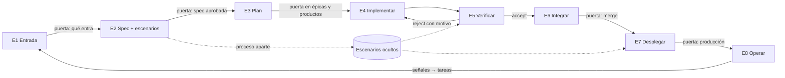
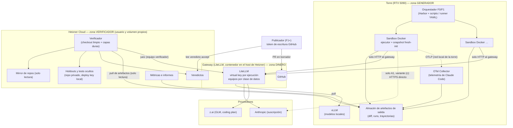
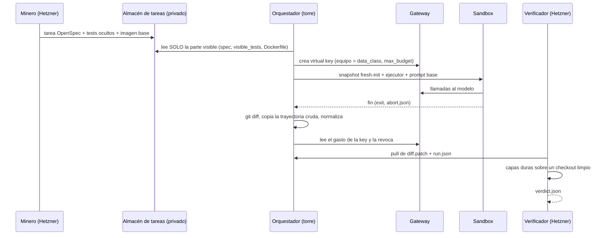
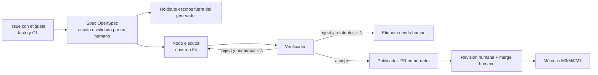

# 02 · Arquitectura

> **Resumen.** Hay tres zonas de confianza: el **generador** (la torre con la RTX 5090: sandboxes Docker y vLLM), el **verificador** (Hetzner, con otras credenciales y los holdouts) y el **gateway** (LiteLLM, por donde pasan los modelos y el dinero). El gateway y el verificador comparten un servidor Hetzner Cloud: ahí las zonas se separan por credenciales, usuario, contenedor y volumen, no por máquina. Un orquestador determinista mueve artefactos entre ellas, siempre con pull desde Hetzner. Los LLM solo viven en los nodos de ejecución y en las señales blandas. En F0 orquestan Harbor y unos scripts; en F1, un runner mínimo de pipelines YAML. Cada componente justifica en §7 la métrica que mueve o la restricción que cumple.

> **Rediseño del 2026-11-02** ([ADR-0012](adr/0012-stage-chain-and-profiles.md)). La factory es una cadena de ocho etapas con perfiles de software intercambiables (§0). Las capas y flujos de §1–§4 describen el núcleo, las etapas E4 (implementar) y E5 (verificar), y siguen valiendo tal cual.

## 0. La cadena de etapas y los perfiles

- **Orquestador**: una máquina de estados que lleva cada unidad de trabajo (issue, épica, producto) por las etapas que le tocan según su tipo ([06](06-harness-and-tasks.md) §4). Ningún LLM decide la transición. Las puertas humanas son estados que esperan una aprobación registrada.
- **Artefacto por etapa**: E2 entrega la spec (OpenSpec) y los escenarios visibles; E3, un plan de tareas con dependencias; E4, un diff por tarea; E5, un veredicto; E6, un PR; E7, una versión desplegada con su resultado de escenarios; E8, entradas nuevas para E1.
- **Escenarios ocultos**: los escribe un proceso que solo recibe la spec aprobada y no comparte sandbox, credenciales ni historial con el constructor. Viven junto a los tests ocultos, en el almacén que ningún sandbox monta ([ADR-0011](adr/0011-single-host-f0.md)).
- **Perfil de software**: una pieza con tres partes, entorno, oráculo y despliegue ([06](06-harness-and-tasks.md) §7). E4 pide el entorno al perfil, E5 y E7 piden el oráculo y E7 el despliegue. El resto de la cadena no sabe qué perfil corre.

| Etapa | Pieza | Reutilizar o construir | Fase |
|---|---|---|---|
| E1 | Cola de entradas (issues etiquetados, incidentes, ideas) | Reutilizar GitHub Issues | C |
| E2 | Redactor de spec + escritor de escenarios ocultos | Construir (prompts y validadores) | B |
| E3 | Planificador de tareas con validador de cobertura | Construir | B |
| E4 | Contrato de ejecutor, adaptadores, Harbor, gateway | Hecho en la fase A | A |
| E5 | Verificador antitrampas + oráculo del perfil | Verificador hecho; oráculo de app web por construir | A, B |
| E6 | Review agéntica + publicador de PRs | Construir fino | C |
| E7 | Despliegue del perfil + ejecución de escenarios | Construir | B (staging), C |
| E8 | Lector de señales de producción → E1 | Construir | C |

## 1. Capas

| # | Capa | Pieza | Reutilizar o construir |
|---|---|---|---|
| L1 | Intake de tareas | Carpetas OpenSpec ([ADR-0005](adr/0005-task-format.md)); en F0 las genera el minero, en F1 un issue etiquetado | Formato reutilizado; minero propio ([06](06-harness-and-tasks.md)) |
| L2 | Orquestación | F0: Harbor + scripts. F1: runner mínimo de pipelines YAML ([ADR-0002](adr/0002-orchestrator.md)) | Reutilizar en F0; construir fino en F1 |
| L3 | Contrato de ejecutor | Esquemas + adaptadores ([04](04-executor-contract.md)) | Construir (fino sobre los agentes de Harbor) |
| L4 | Sandbox | Docker con red restringida y snapshot sin historial ([ADR-0003](adr/0003-sandbox.md)) | Reutilizar Docker; construir el snapshot y la red |
| L5 | Gateway | LiteLLM con virtual keys, equipos por clase de datos y precios sombra ([ADR-0004](adr/0004-gateway.md)) | Reutilizar |
| L6 | Serving local | vLLM en la 5090 | Reutilizar |
| L7 | Verificación | Verificador aislado ([05](05-verification-design.md)) | **Construir** |
| L8 | Publicación (F1+) | Publicador de safe outputs: aplica el diff verificado y abre el PR en borrador | Construir (poco código) sobre la API de GitHub |
| L9 | Telemetría y datos | JSONL crudo + normalizador + OTel Collector; métricas por script ([01](01-metrics.md), [ADR-0006](adr/0006-trajectory-store.md)) | Reutilizar el Collector; construir el normalizador y las métricas |

## 2. Despliegue: dónde corre cada pieza

> **En F0 rige [ADR-0011](adr/0011-single-host-f0.md)**: el host del gateway es aarch64 y no puede ejecutar las imágenes x86_64 de las tareas, así que el verificador, el minero y el almacén oculto viven en la torre. La separación de esta sección se aplica por proceso y por montaje, no por máquina. Se revisa antes de F1.

- **Dónde vive el gateway**: se reutiliza la instancia LiteLLM existente del propietario, con equipos y claves dedicados a la factory. Su host está en `factory-pilot-data`, no en este repo. Es un servidor Hetzner Cloud sin `/dev/kvm` que también aloja el verificador y servicios de otros proyectos del propietario [Cierto, comprobado el 2026-11-01]. Si la configuración de equipos o de precios choca con otros usos, se separa en una instancia propia ([ADR-0004](adr/0004-gateway.md), cómo revertir).
- **La torre no puede llegar a los holdouts**: no tiene la deploy key, y su única ruta de red hacia el host de Hetzner es el puerto del gateway. **Todo movimiento de datos entre zonas es un pull desde Hetzner** (artefactos, trayectorias, telemetría). La torre nunca empuja nada a Hetzner.
- **El OTel Collector vive en la torre**, en la red interna de los sandboxes junto al gateway. Recibe la telemetría de Claude Code y la escribe como JSONL en el almacén de artefactos, de donde Hetzner la recoge. Los sandboxes no tienen más ruta hacia Hetzner que el puerto del gateway.
- **Separación en el host compartido**. El verificador corre con un usuario de sistema propio y **Docker rootless**. El mirror y los holdouts viven en un volumen que solo ve ese usuario. LiteLLM y los demás servicios del host corren en contenedores que no montan ese volumen. Un usuario con acceso al socket de Docker del sistema es root a efectos prácticos [Cierto, [Docker security](https://docs.docker.com/engine/security/#docker-daemon-attack-surface)], así que sin Docker rootless la separación por usuario no vale nada. En F0 basta, porque los tests ocultos son públicos en Hugging Face y solo deben quedar fuera del alcance del agente. Para F1, con código del cliente, es requisito de entrada; si no se puede cumplir, el verificador pasa a otra máquina ([07](07-roadmap.md) F1).
- **El publicador** corre en Hetzner (o donde viva el token de GitHub) y no en la torre. Es el único proceso con permiso de escritura en GitHub, y solo actúa sobre veredictos `accept` cuyo `diff_sha` coincide.

## 3. Flujo F0 (baseline)

**El almacén de tareas se divide en dos**. La parte visible (spec, tests visibles y Dockerfile) se replica a la torre. La parte oculta (parche de tests, F2P/P2P y holdouts) solo existe en Hetzner. El minero corre en Hetzner porque necesita ver los parches de tests.

## 4. Flujo F1 (issue → PR en borrador)

- El grafo es un fichero YAML versionado (`pipelines/issue-to-draft-pr.yaml`) que valida contra `schemas/pipeline.schema.json`. El DOT se genera a partir de él solo para dibujarlo ([ADR-0002](adr/0002-orchestrator.md)).
- Los reintentos son deterministas, por defecto 2, y solo reciben la **categoría** del rechazo, según la lista blanca de [05](05-verification-design.md) principio 7. Nunca valores, nombres ni trazas de tests ocultos o holdouts (amenaza T28).
- `needs-human` tras N fallos sigue la regla de [dark-factory-experiment](https://github.com/coleam00/dark-factory-experiment) (referencia de diseño; el repo no tiene licencia) [Cierto en la ausencia de licencia, verificada el 2026-10-31].

## 5. Fronteras de confianza y credenciales

| Proceso | Ve | No ve nunca | Credenciales |
|---|---|---|---|
| Ejecutor (sandbox) | Snapshot de la base, spec visible, tests visibles (solo lectura) | Tests ocultos, holdouts, historial futuro, otros runs, token de GitHub | Una virtual key efímera con `max_budget` y modelos del equipo de su `data_class` |
| Orquestador (torre) | La parte visible de las tareas, los artefactos de sus runs | Holdouts, tests ocultos | **Solo un token del servicio de emisión de keys**. Una key creada con `team_id` hereda las restricciones de modelos del equipo [Cierto, [model access](https://docs.litellm.ai/docs/proxy/model_access)], pero el rol de *team admin* de LiteLLM es de pago (`team_endpoints.py`, tag v1.86.2) [Cierto, `notas:conocimiento/infra/litellm-gateway-que-se-puede-hacer.md`]. Por eso un **servicio mínimo de emisión en Hetzner** custodia la master key y solo expone `mint(data_class, budget_usd, ttl)` y `spend/revoke(key)`, con los equipos de generación fijados en su configuración. El orquestador no puede emitir keys del equipo verificador |
| Importador y minero (Hetzner) | Los datasets públicos fijados (F0); desde F1, el historial completo del repo piloto | — | Lectura de los datasets o del repo; escritura en el almacén de tareas |
| Verificador (Hetzner) | Diff, tarea completa, holdouts, mirror | El contenedor y el entorno del agente | Deploy key de holdouts; virtual key del **equipo verificador** (juez) |
| Publicador | Veredictos y diffs aceptados | Holdouts, trayectorias | Token de GitHub App con alcance de PR en borrador, sin permiso de merge |
| Humano | Todo | — | — |

## 6. Red

- **El gateway se publica detrás de Cloudflare**: su nombre resuelve a IPs anycast compartidas con muchas otras webs [Cierto, DNS del 2026-11-01]. Una regla por `IP:puerto` en `DOCKER-USER`, que era el diseño del 2026-10-31, abriría todas esas webs, así que se descarta.
- **Salida del sandbox**: modo `network_mode = "allowlist"` de Harbor, con `allowed_hosts` igual al nombre del gateway (el valor está en el almacén privado). Harbor lo aplica con un sidecar que filtra **por SNI** (gost) y con nftables `fib inet` [Cierto, `harbor-docker-egress-control-sidecar/bin/network-policy`, v0.25.0]. **Probado en la torre el 2026-11-01** con `network-probe`: el gateway es alcanzable, y example.com, `api.github.com` y otra web de la misma Cloudflare no lo son (reward 1) [Cierto]. Si el kernel no soporta el sidecar, Harbor rechaza la tarea, así que falla de forma cerrada.
- **Riesgo residual**: el sidecar deja pasar DNS hacia los resolvedores de `resolv.conf` [Cierto, mismo fichero]. El sandbox puede hacer consultas DNS, que son un canal de exfiltración lento pero no sirven para descargar un fix. Se acepta en F0. Si aparece en las trayectorias, se añade un resolvedor propio que solo responda al nombre del gateway.
- El OTel Collector local se añade a la lista blanca por IP cuando entre la telemetría de Claude Code (F0-13).
- El verificador ejecuta los tests con `--network none`, salvo en las tareas que declaren gemelos de servicios (WireMock o Testcontainers) en su propia red interna.

## 7. Justificación de cada componente (minimalismo verificable)

| Componente | Métrica que mueve o restricción que cumple | Si no estuviera… |
|---|---|---|
| Harbor (runner) | Permite medir M1, M2 y M5 a escala con concurrencia | Habría que escribir un runner paralelo: tesis 1 |
| Contrato + adaptadores | Tesis 4 (agnóstico). Hace comparable M1 y M2 entre agentes | Las métricas dependerían del formato de cada CLI |
| Snapshot fresh-init | Amenaza T15 → M2 y M5 válidos | El agente podría leer el fix del historial |
| Red solo al gateway | T16 + presupuesto aplicado + ADR-0009 | Fuga de datos, coste sin medir, fix descargado de la red |
| Gateway con virtual keys | M1 (coste real y sombra), presupuesto por run, ADR-0009 | Sin coste fiable ni política de datos aplicada |
| Servicio de emisión de keys (~100 líneas, en Hetzner) | Restricción: la master key no puede estar en la zona del generador, y el *team admin* de LiteLLM es de pago | El orquestador tendría la master key y podría crear keys de cualquier equipo (incluido el verificador) |
| Precios sombra > 0 | M1 de los modelos gratuitos. Además, **LiteLLM se salta los checks de presupuesto si el coste del modelo es 0** [Cierto en la bandera de código `user_api_key_auth.py`; Probable en que afecte al budget de la key], así que precio 0 = sin fusible | Brazos gratuitos con M1 = 0 y sin corte de presupuesto |
| Verificador en otra máquina | Tesis 2 + T17/T18 → M5 creíble | Holdouts legibles por convención, no por construcción |
| Contenedor efímero de verificación | T29 (el código candidato ataca al verificador) | El código bajo prueba compartiría el disco con los holdouts y la deploy key |
| Mirror del verificador | Tesis 2: checkout limpio que no controla el generador | El verificador clonaría lo que el generador pudiera modificar |
| Minero de tareas | Tesis 1 (se construye) → M2 y M5 válidos sobre tareas propias | Habría que usar benchmarks públicos contaminados |
| Normalizador de trayectorias | Tesis 1 (se construye). M1 por ejecutor (diagnóstico de dónde va el coste) y revisión de canarias (M5) | Un análisis distinto por formato de CLI |
| vLLM | Brazos A4/A5 (M1 con modelo local) | Sin brazo local |
| OTel Collector (en la torre) | M1: conciliación del coste de Claude Code (`claude_code.cost.usage`) con el gateway | Sin conciliación. Si se demuestra innecesaria en F0, se quita |
| lizard, jscpd, PyDriller | M7a, M7b, M7d/e y M4 | Sin métrica de mantenibilidad ni de regresiones |
| Forge (GitHub) | Intake (issues) y salida (PR en borrador) en F1. M3 y M6 | Ver [03](03-reuse-inventory.md): interfaz mínima de forge y eventos exportados a JSONL |
| Mutation (informativo en F0) | T04/T05 y la evidencia de C4 (mutantes del verificador) | Tests tautológicos y código no ejercitado sin detectar |
| SAST con reglas propias | T03, T06, T07, T22 | Trampas de código sin detectar |
| Juez de otro vendor (F2) | M3 (desempate en best-of-n) | Best-of-n elegiría al azar entre verdes |
| Critic 4B (F2, condicional) | Solo entra si se correlaciona con M2 en F2 | No se construye |
| Cross-check (F2, condicional) | Solo entra si mejora M3 o M4 | No se construye |
| Runner de pipelines YAML (F1) | Tesis 3 (determinista) y reproducibilidad del pipeline (grafo versionado + checkpoints). La portabilidad entre motores ya no es un argumento ([ADR-0002](adr/0002-orchestrator.md) §4) | El flujo estaría en código imperativo sin un grafo revisable |
| Publicador | Safe outputs: el ejecutor no tiene escritura (gh-aw, Eve) | El agente tendría el token de GitHub |
| NATS JetStream | **No está en F0 ni en F1.** Entra en F2 solo si el fan-out de best-of-n o la cola de issues lo necesitan (métrica: M6 limitado por la cola) | — |
| Langfuse, Opik o Docent (UI de trazas) | **No está en F0.** Docent como piloto en F1 si el análisis por lotes de trayectorias detecta clusters de trampa que M5 no ve | — |
| Equipo de roles | **No está.** Solo entraría si el harness mide que mejora M1 o M3 frente a un solo agente | — |

## 8. Matriz de datos × proveedor

Detalle en el [ADR-0009](adr/0009-data-policy-per-repo.md). Se aplica en el gateway: cada `data_class` es un equipo de LiteLLM con su lista de modelos permitidos, y la lista de modelos por key o por equipo está en la versión OSS [Cierto, [model access](https://docs.litellm.ai/docs/proxy/model_access)].

| `data_class` | Local (5090) | z.ai GLM | API de Anthropic | API de OpenAI | Otros proveedores gratuitos o de cuota |
|---|---|---|---|---|---|
| `public` (repo fixture, la factory) | sí | sí | sí | sí | sí |
| `internal` | sí | sí | sí | sí | según los términos de retención |
| `client-product` (piloto) | sí | sí | sí | **no** (D1) | **NaN y OpenRouter sí** (D1, 2026-11-01). En OpenRouter, sin modelos `:free` y con `data_collection: deny`; el resto, no |
| `client-restricted` | sí | no | sí | no | no |

## Decisiones abiertas

- Si el gateway compartido admite equipos dedicados sin interferir con otros usos, o si conviene una instancia propia desde el principio.
- Resuelto el 2026-11-01: el servidor Hetzner es Cloud, sin `/dev/kvm` [Cierto]. Si en F2 se activa el [ADR-0003](adr/0003-sandbox.md), hace falta otra máquina.
- Dónde vive el almacén de artefactos de la torre (disco local o MinIO). Por minimalismo, disco local + `rsync` pull desde Hetzner en F0.
