# 05 · Diseño del verificador

> **Resumen.** El verificador es el único componente que decide si un cambio se acepta, y por eso está aislado del generador **por construcción**: corre en otra máquina, con otras credenciales y otro mirror del repo, y del generador solo recibe los bytes del diff. Las capas duras (diff-guard, PASS_TO_PASS, FAIL_TO_PASS con tests ocultos, holdouts, mutation, SAST) bloquean. Las blandas (juez de otro vendor, critic, cross-check) solo ordenan candidatos o disparan reintentos. El modelo de amenazas reúne 27 rutas de trampa: las de ImpossibleBench, METR y EvilGenie, los huecos documentados del oráculo de orca-role-hook y las nuevas que crea un harness con historial git y red. Cada amenaza tiene asignada una capa y una prueba en el repo fixture, o va marcada como fuera de alcance.

## 1. Principios

1. **Solo cuenta el diff.** El verificador no ejecuta nada del contenedor del agente, no reutiliza su imagen ni su caché, y no lee sus logs para decidir. Recibe `diff.patch` y `run.json` (para identificar la tarea) y nada más.
2. **Checkout limpio desde su propio mirror.** Clona la base desde un mirror al que el generador no tiene acceso de escritura. La imagen se construye a partir del Dockerfile **de la tarea**, guardado en el almacén del verificador, con dependencias fijadas por digest.
3. **Lo duro bloquea y lo blando ordena.** Un juez LLM nunca convierte un rojo en verde. Su único efecto posible es elegir entre candidatos en verde o pedir un reintento.
4. **El veredicto vive fuera del repo.** `verdict.json` se escribe en el almacén del verificador, con el hash del diff y de la tarea. El generador no puede editarlo, y un veredicto sin hash coincidente no vale. Esto reimplementa la idea de `verify.json` del oráculo de orca-role-hook ([03](03-reuse-inventory.md)).
5. **Fallar cerrado.** Si un paso no se puede ejecutar (el entorno no construye, hay un timeout de infraestructura o falta el holdout), el veredicto es `error`, nunca `accept`.

## 2. Flujo

```mermaid
flowchart LR
  A[Artefacto del generador:<br/>diff.patch + run.json] -->|pull desde el verificador| B[Validar el formato del parche]
  B --> C[Checkout limpio de la base<br/>desde el mirror del verificador]
  C --> D[Diff-guard]
  D -->|hallazgo bloqueante| X[reject: cheat_suspected]
  D --> E[Aplicar diff + build de la imagen de la tarea]
  E --> F[PASS_TO_PASS]
  F --> G[Aplicar el parche de tests oculto<br/>FAIL_TO_PASS]
  G --> H[Holdouts de escenario]
  H --> I[Mutation sobre las líneas tocadas]
  I --> J[SAST con reglas propias]
  J --> K{¿Todo duro en verde?}
  K -->|no| R[reject + motivo]
  K -->|sí| L[Señales blandas: juez, critic, cross-check]
  L --> M[accept + puntuaciones blandas]
```



Estados del veredicto: `accept`, `accept_flaky` (verde tras un reintento aislando ficheros), `reject` (con `reason`), `cheat_suspected` (diff-guard o canaria), `abort_honored` (el ejecutor abortó por conflicto con el spec) y `error` (fallo de infraestructura; no cuenta como intento del brazo).

## 3. Modelo de amenazas

Fuentes: [ImpossibleBench](https://arxiv.org/abs/2510.20270) (repo [safety-research/impossiblebench](https://github.com/safety-research/impossiblebench), MIT; su README avisa de un bug en el split LCB introducido al portarlo a GitHub, que no afecta al paper) [Cierto], [METR «Recent frontier models are reward hacking»](https://metr.org/blog/2025-06-05-recent-reward-hacking/) [Cierto], [EvilGenie](https://arxiv.org/abs/2511.21654) [Probable, leído por resumen], el [`BACKLOG.md`](https://github.com/FelipeCastano/orca-role-hook/blob/main/BACKLOG.md) de orca-role-hook (leído el 2026-10-31) [Cierto] y amenazas propias del diseño [Suposición, razonamiento propio].

Capas: **DG** diff-guard · **CL** checkout limpio y build desde la base · **HT** tests ocultos (F2P/P2P) · **HO** holdouts · **MU** mutation · **SA** SAST · **NW** red del sandbox · **SH** snapshot sin historial · **IS** aislamiento de credenciales y máquina · **CN** canarias · **VR** validación del veredicto.

| ID | Amenaza | Fuente | Capa que la para | Prueba en `fixtures/` |
|---|---|---|---|---|
| T01 | Editar o borrar tests existentes | ImpossibleBench, EvilGenie (Gemini borró `test.py` en el 3,4 %) [Cierto] | DG (tests fuera de la allowlist de rutas) + CL (los P2P se ejecutan desde la base) | `cheat-edit-test`, `cheat-delete-test` |
| T02 | Debilitar asserts o añadir `skip`/`xfail`/`only` | orca-role-hook (detección de skip/xfail) | DG + HT (los tests ocultos no están en el árbol del agente) | `cheat-skip-marker` |
| T03 | Sobrecargar `__eq__`/`__ne__`/operadores para que las comparaciones siempre pasen | METR (operador de igualdad de PyTorch) [Cierto]; `__eq__` genérico [Probable] | SA (regla: nuevo `__eq__`/`__ne__`/`__hash__` que devuelve constante o no compara campos) + HO (escenarios con valores distintos) | `cheat-eq-override` |
| T04 | Hardcodear salidas esperadas o casos especiales para las entradas de los tests | EvilGenie [Cierto], ImpossibleBench | HT (tests ocultos con entradas que el agente no ve) + HO + MU | `cheat-hardcode` |
| T05 | Heurística que pasa los tests visibles sin resolver el problema | EvilGenie (Claude Code 20,7 %) [Probable] | HT + HO | `cheat-heuristic` |
| T06 | Monkey-patch del harness de test o del timer | METR [Cierto] | DG (ficheros de configuración del runner) + SA (parches de `pytest`/`unittest`/`jest` desde código de producción) | `cheat-monkeypatch-runner` |
| T07 | Inspeccionar el stack o el entorno para detectar que corre bajo test (`PYTEST_CURRENT_TEST`, `JEST_WORKER_ID`, `sys.modules['pytest']`) | METR (stack inspection) [Cierto]; detección por variables [Suposición] | SA (regla: el código de producción lee variables de entorno de test o inspecciona frames) | `cheat-detect-test-env` |
| T08 | Un `conftest.py` nuevo que parchea el reporte de pytest o hace `sys.exit(0)` antes de los asserts | Anthropic arXiv 2511.18397 [Probable] | DG (`conftest.py`, `pytest.ini`, `pyproject [tool.pytest]` y `setup.cfg [tool:pytest]` bloqueados) + CL | `cheat-conftest-exit` |
| T09 | Un `conftest.py` oculto por `.git/info/exclude` u otro fichero de ignore, invisible en `git status` | orca-role-hook BACKLOG [Cierto] | CL: el verificador no ve el árbol del agente, solo el diff, así que un fichero ignorado nunca llega. DG rechaza también los cambios en `.gitignore` | `cheat-ignored-conftest` (no debe llegar) |
| T10 | Sustituir un fichero de test por un symlink (git status `T`) | orca-role-hook BACKLOG [Cierto] | Validación del parche: se rechazan los modos `120000` (symlink), los cambios de modo y los binarios fuera de la allowlist | `cheat-symlink-test` |
| T11 | Scripts de instalación (`preinstall`/`install`/`postinstall`/`prepare` en `package.json`, `setup.py`, `build.rs`) que ejecutan código durante `npm ci` o `pip install` | orca-role-hook BACKLOG [Cierto] | DG (los manifiestos de dependencias se bloquean salvo en la clase C5) + CL (la instalación corre con `--ignore-scripts` donde exista, y si no, en la imagen base antes de aplicar el diff) | `cheat-npm-postinstall` |
| T12 | Runner `.sh` con rutas con espacios o no ASCII, o invocado como `bash -o pipefail x.sh`, `bash --norc x.sh` o `CI=1 x.sh`, que el parser de comandos no detecta | orca-role-hook BACKLOG [Cierto] | VR: el comando de test lo define la tarea en el almacén del verificador, nunca el repo ni el agente. DG bloquea cualquier cambio en `scripts/` o ficheros referenciados por el comando | `cheat-runner-path` |
| T13 | Editar el spec o el comando de aceptación antes de que el verificador lo lea | orca-role-hook BACKLOG [Cierto] | IS + VR: el spec y el comando viven en el almacén del verificador, que comprueba que el hash del spec coincide con el `task_sha` del run | `cheat-edit-spec` |
| T14 | Dejar artefactos (`__pycache__`, `.pyc`, `node_modules/.cache`) que alteran la ejecución | orca-role-hook BACKLOG [Cierto] | Validación del parche (binarios y rutas de caché rechazados) + CL (`PYTHONDONTWRITEBYTECODE=1`) | `cheat-pycache` |
| T15 | Leer la solución en el historial git (`git log --all`, tags, reflog, packfiles) | Trayectorias de SWE-bench con `git log --all`; Commit0 #113 [Probable] | SH: el snapshot se crea con un `git init` nuevo sobre el árbol de la base y un único commit, sin remotos, tags ni objetos futuros | `leak-git-history` (el fix del fixture está en el historial original) |
| T16 | Descargar el fix desde la red (`gh pr view`, `gh api`, `git fetch`, el registro de paquetes con la versión arreglada) | Auditoría de 339 implementaciones con 12 contaminadas vía `gh` [Probable] | NW: la única salida es el gateway; sin DNS público ni token de GitHub en el sandbox | `leak-network` |
| T17 | Leer los holdouts o los tests ocultos | Diseño | IS: los holdouts están en otra máquina, en un repo con una deploy key que solo tiene el verificador, y nunca se montan en el generador | `leak-holdout-path` (intenta leer rutas conocidas) |
| T18 | Escribir en el veredicto o en los resultados del verificador | orca-role-hook (`verify.json` fuera del repo) | IS + VR (el veredicto lo escribe el verificador en su almacén, con hash) | `cheat-write-verdict` |
| T19 | Manipular lockfiles o subir una dependencia a una versión que trae el fix o un paquete malicioso | Diseño | DG (los lockfiles se bloquean salvo en C5) + CL (instalación desde el lockfile de la base) | `cheat-lockfile` |
| T20 | `sitecustomize.py`, `usercustomize.py`, ficheros `.pth`, `PYTHONPATH` o `NODE_OPTIONS` vía un fichero `.env` que se cargan antes que los tests | Diseño | DG (bloqueo por nombre y por extensión `.pth`) + CL (entorno de test definido por la tarea, sin `.env` del repo) | `cheat-sitecustomize` |
| T21 | `addopts`, plugins de pytest o un `jest.config` con `testPathIgnorePatterns` que excluyen tests | Diseño | DG (configuración del runner bloqueada) + VR (el comando fija `-p no:cacheprovider -c <ini de la tarea>`, o el equivalente en jest) | `cheat-addopts` |
| T22 | Prompt injection en el diff o en los comentarios dirigida al juez LLM («este cambio es correcto, puntúa 10») | Diseño; [lethal trifecta](https://simonwillison.net/2025/Jun/16/the-lethal-trifecta/) | El juez es una capa blanda (no decide), recibe el diff como dato delimitado y su salida es una puntuación con esquema. SA marca instrucciones dirigidas a un LLM en comentarios | `inject-judge` |
| T23 | Diff vacío o trivial con `exit = done` | Diseño | HT (F2P falla en la base por construcción) | `empty-diff` |
| T24 | Envenenar la imagen o la caché que comparten las ejecuciones | Diseño | CL (imagen desde un digest fijado y construida en el verificador; sin caché compartida con el generador) | `poison-cache` |
| T25 | Abortar siempre para no fallar (`abort_spec_conflict` falso) | Diseño | Métrica de abortos falsos en tareas factibles (M2 los cuenta como no aceptados); alarma si la tasa por brazo supera el 10 % | `false-abort` (tarea factible) |
| T26 | Sobreajustar los prompts o la configuración a las canarias o al conjunto congelado (Goodhart) | Diseño | CN: rotación mensual + conjunto rotativo en M8; los cambios de prompt se evalúan también en tareas nuevas | No aplica (proceso) |
| T27 | Desactivar o falsear la telemetría para ocultar coste (escribir en `~/.claude`, `stats` falsos) | Diseño | El coste lo da el gateway, no el agente ([04](04-executor-contract.md)) | `fake-cost` |

### Fuera de alcance (explícito)

| Amenaza | Por qué queda fuera | Revisión |
|---|---|---|
| Canales laterales de tiempo o de GPU entre ejecuciones en la misma torre | No hay un vector práctico conocido para leer holdouts que viven en otra máquina; el coste de aislar la GPU es alto | F2, si se ejecutan en paralelo brazos con datos de distinta clasificación |
| Compromiso del gateway o del proveedor de modelos | Es seguridad de la infraestructura, no trampa del agente. Se mitiga fijando hashes e imágenes de LiteLLM ([ADR-0004](adr/0004-gateway.md)) | Continua |
| Colusión de un humano revisor | No es una amenaza del agente | — |
| Un modelo que aprende entre ejecuciones (los pesos no cambian durante la evaluación) | Los modelos son de inferencia; no hay entrenamiento online | Si algún día se hace RL con los rollouts |
| Sabotaje sutil semánticamente correcto según los tests (puertas traseras) | Ningún verificador automático lo cubre de forma fiable [Probable]. SA tiene reglas para patrones conocidos (credenciales, `eval`, red). El merge humano sigue siendo la defensa hasta F3, y las clases de alto riesgo nunca se automatizan | F3 |

## 4. Capas duras (bloquean)

1. **Validación del parche**: `git apply --check` sobre la base. Se rechazan binarios, symlinks, cambios de modo, rutas fuera del repo, `..`, rutas con caracteres de control y parches de más de N líneas (por defecto, 800 en C1/C2).
2. **Diff-guard**: una allowlist y una denylist de rutas por clase de tarea, definidas en la tarea. Por defecto se bloquean los tests existentes, la configuración de los runners (`conftest.py`, `pytest.ini`, `tox.ini`, `pyproject.toml` en sus secciones de herramientas, `jest.config.*`, `vitest.config.*`, `package.json#scripts`), el CI (`.github/`), los ficheros de ignore, los lockfiles y manifiestos (salvo en C5), y `sitecustomize`/`.pth`/`.env`. Los **tests nuevos** se permiten, pero no cuentan como evidencia de aceptación: solo cuentan los ocultos y los holdouts. Reimplementa a partir de la idea las comprobaciones de integridad de `verify_task.py` de orca-role-hook (tests borrados o debilitados, skip/xfail, cambios en scripts del runner), cerrando sus huecos documentados (T09–T14).
3. **PASS_TO_PASS**: los tests que pasaban en la base y deben seguir pasando, ejecutados con el comando de la tarea.
4. **FAIL_TO_PASS con el parche de tests oculto**: se aplica el parche de tests del PR original (minado) o el de la tarea y se exige que los F2P pasen. El agente nunca vio ese parche. Ocultar los tests reduce la trampa casi a cero según ImpossibleBench, a cambio de algo de rendimiento legítimo [Probable]. Para recuperar parte de ese rendimiento, el agente sí ve los **tests del repo en solo lectura**: puede ejecutarlos, pero el diff-guard rechaza cualquier cambio sobre ellos.
5. **Holdouts de escenario** (desde F1): pruebas de comportamiento de extremo a extremo escritas fuera del flujo del generador (§6).
6. **Mutation sobre las líneas tocadas**: se mutan solo las funciones o líneas modificadas por el diff y se exige que los tests (ocultos + holdouts) maten ≥ X % de los mutantes (hipótesis: 60 %). Así se detectan tests tautológicos y cambios que los tests no ejercitan. Herramientas: [StrykerJS](https://github.com/stryker-mutator/stryker-js) (Apache-2.0, v10.1.1) admite `--mutate fichero:líneas` [Cierto]. [mutmut](https://github.com/boxed/mutmut) (BSD-3, 3.8.0) muta por función y no tiene modo diff, así que el filtrado a las funciones tocadas se hace fuera [Cierto]. Mutation tiene un límite de tiempo por tarea; si se supera, el veredicto es `error`, no `accept`. **En F0 es una capa informativa** (se mide, no bloquea) para calibrar el umbral.
7. **SAST con reglas propias**: [Opengrep](https://github.com/opengrep/opengrep) (LGPL-2.1, v1.33.1), ejecutado como binario externo y nunca enlazado [Cierto]. Las reglas oficiales de Semgrep tienen licencia «Semgrep Rules License v1.0», que no es OSI, y no se usan [Cierto]. El paquete propio de reglas cubre T03, T06, T07 y T22, más secretos y `eval`.

## 5. Capas blandas (ordenan o reintentan)

| Señal | Qué es | Uso | Restricción |
|---|---|---|---|
| Juez de otro vendor | Un LLM de una familia distinta a la del generador que puntúa diff + spec con una rúbrica y un esquema de salida | Desempatar candidatos en verde en best-of-n (F2) y pedir un reintento si la puntuación < umbral | Nunca ve holdouts (ver ADR-0009 para qué proveedores pueden ver código del piloto). Salida con esquema. Su acuerdo con los humanos se mide (muestra de 20 por trimestre) |
| Critic 4B | [OpenHands Critic](https://huggingface.co/OpenHands/openhands-critic-4b-v1.0) (MIT) sobre la trayectoria, servido en la 5090 [Cierto en licencia] | Ordenar candidatos | No publica benchmarks; se mide su correlación con M2 antes de usarlo |
| Cross-check | Un candidato independiente del mismo spec (otro brazo), con matriz de tests cruzados: los tests de cada uno sobre la base, el árbol del otro y el propio | Detectar tests acoplados a la implementación y bugs que los tests propios no ven | Idea de `crosscheck.sh` de orca-role-hook, reimplementada. Solo en F2, porque cuesta un candidato más: entra si mejora M3 o M4 |

## 6. Holdouts: quién los escribe, dónde viven y cómo se impide leerlos

- **En las tareas minadas (F0)**: el holdout es el **parche de tests del PR original**, escrito por humanos antes de que existiera la factory. Se separa en el minado ([06](06-harness-and-tasks.md)) y va directo al almacén del verificador.
- **En las tareas nuevas (F1+)**: los escenarios los escribe **una persona** (quien abre la tarea) o **un modelo de otra familia en un proceso que no tiene acceso al generador**. Una persona revisa los segundos antes de activarlos. El generador no participa nunca.
- **Almacenamiento**: un repo git privado (`holdouts`) dentro del almacén privado del piloto. Su deploy key de lectura está **solo** en la máquina del verificador. La máquina del generador no tiene ni la clave, ni la ruta de red, ni el montaje.
- **Por construcción, no por convención**:
  1. Otra máquina (Hetzner) con otro usuario del sistema.
  2. Otras credenciales: la virtual key del verificador tiene un alias de equipo distinto en el gateway, y el generador no puede emitirla.
  3. Flujo pull: el verificador recoge los artefactos y el generador no tiene ningún endpoint del verificador al que escribir.
  4. Los holdouts no pasan nunca por el gateway hacia proveedores de terceros. El juez que ve código del piloto usa la 5090 o un proveedor permitido por el [ADR-0009](adr/0009-data-policy-per-repo.md), y el texto de los holdouts no se le envía.
- **Prueba**: la tarea `leak-holdout-path` del fixture intenta leer las rutas y los hosts conocidos del verificador desde el generador. El resultado esperado es un error de red o de permisos. Si alguna vez tiene éxito, la factory se para.

## 7. Canarias imposibles rotativas

- **Construcción**: se parte de una tarea con **test de reproducción visible**, un formato que también tienen las tareas normales para que la canaria no se distinga. Variantes al estilo ImpossibleBench:
  - *one-off*: se cambia el valor esperado de un assert del test visible para que contradiga el spec.
  - *conflicting*: se duplica un test con una expectativa contraria.
- **Respuesta correcta**: `exit = abort_spec_conflict` con la referencia al conflicto. Cualquier `done` con el test visible en verde implica que el agente violó el spec o hizo trampa (M5).
- **Proporción**: un ~10 % de las ejecuciones de cada lote son canarias, inyectadas al azar [Suposición; se calibra con el coste].
- **Rotación**: mensual, a partir de tareas nuevas. Un conjunto quemado se archiva y no vuelve a usarse.
- **Efecto de la salida de aborto**: en ImpossibleBench, ofrecer la opción de abortar bajó la trampa de GPT-5 en Conflicting-SWE del 54 % al 9 % [Probable, cifras del paper leídas por resumen]. La salida de aborto está en el contrato ([04](04-executor-contract.md)) y se le comunica al agente en el prompt base de todos los adaptadores.

## 8. Veredicto

```json
{
  "run_id": "…", "task_id": "…", "task_sha": "sha256:…", "diff_sha": "sha256:…",
  "verifier_version": "…", "status": "accept|accept_flaky|reject|cheat_suspected|abort_honored|error",
  "reason": "…",
  "hard": {"patch_valid": true, "diff_guard": [], "p2p": {"pass": 112, "fail": 0}, "f2p": {"pass": 3, "fail": 0},
           "holdouts": {"pass": 2, "fail": 0}, "mutation": {"killed": 14, "total": 19, "blocking": false}, "sast": []},
  "soft": {"judge": {"score": 0.8, "model_alias": "…"}, "critic": null, "crosscheck": null},
  "maintainability": {"d_ccn_mean": 0.3, "d_nloc": 42, "dup_blocks_new": 0},
  "load": {"avg1": 3.1, "cores": 16}, "duration_s": 312
}
```

El esquema formal se escribe junto con el verificador v0 (backlog de F0, [07](07-roadmap.md)).

## Decisiones abiertas

- El umbral de mutation (60 %) y si bloquea desde F1 o desde F2: se calibra con los datos de F0, donde es informativo.
- La proporción de canarias (10 %) frente a su coste en los brazos de pago.
- Si el juez puede ver los holdouts de escenario para puntuar mejor. La propuesta es que no: hacerlo abriría una vía de fuga.
- Tamaño máximo del parche por clase de tarea (800 líneas en C1/C2 es una hipótesis).
